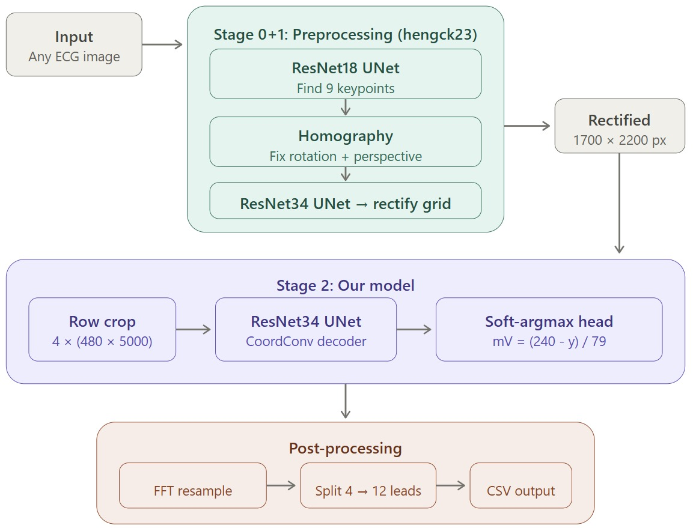

# ECG Image to Signal Digitization

Turns a photo or scan of a paper ECG back into the actual heart signal: 12 leads, in millivolts, over 10 seconds.

Built for the Kaggle competition [PhysioNet ECG Image Digitization](https://www.kaggle.com/competitions/physionet-ecg-image-digitization).
**My score: 19.35 dB SNR**, with a single model (ResNet34 UNet, 24M parameters) trained for about 40 GPU hours.

<p align="center">
  
</p>

## Why it's hard

- The trace sits on a dense 1 mm grid that looks almost the same as the line itself.
- Photos are rotated, tilted and warped.
- Paper can be stained, creased, water-damaged or moldy.
- Each record comes in 9 versions: clean digital, color and B/W scans, phone photos, photos of a screen, stained, damaged and moldy.
- Leads overlap, and there are calibration marks in the way.

## How it works

1. **Straighten the image** (preprocessing reused from [hengck23](https://www.kaggle.com/datasets/hengck23/hengck23-demo-submit-physionet)): find 9 keypoints, fix rotation and perspective, and flatten the grid. Every image comes out the same size, with the leads in the same places.
2. **Cut 4 rows**, one per line of leads on the paper, each 480 px tall.
3. **Find the line** (my model): a ResNet34 UNet with a CoordConv decoder outputs, for every column, a probability for each pixel height. Soft-argmax turns that into one exact height.
4. **Convert to millivolts**: the row center is 0 mV and 79 px is 1 mV, so `mV = (240 − y) / 79`.
5. **Post-process**: resample each row to the right length with FFT, split the 4 rows into the 12 leads, and write the CSV.

## Results

| Experiment | Result |
|---|---|
| Reproduced the top public solution (pretrained weights, 6-model ensemble) | 23.27 dB, the reference point |
| My model, trained on clean images only | 23.33 dB on clean validation, but fails on the real test: it never saw noisy images |
| Fine-tuned on 200 records × 9 image types, curriculum: clean first, then mixed | big jump, about 3 → 17 dB |
| Resampling fix: split leads first, then resample | worse, the model was trained with the old order |
| Einthoven's law correction (II = I + III) | worse, the model isn't accurate enough for physics corrections |
| Retrained with grayscale + augmentations | worse, the augmentations only added noise |
| **Full dataset, 977 records × 9** | **19.35 dB, my best**: same model, 5× more data |

**What worked**

- Soft-argmax + JSD/SNR loss instead of plain segmentation: about +7 dB over a simple UNet.
- Row crops instead of the full image, so the model follows one trace at a time.
- Curriculum learning, clean → mixed, to make the most of a limited GPU budget.
- Diverse training data was the biggest factor: noisy images took it from 3 to 17 dB, the full dataset from 17 to 19 dB.

**What didn't**

- Post-processing corrections (Einthoven, resampling fix): the model isn't accurate enough yet for them to help.
- Grayscale + augmentations: extra noise without benefit.
- Lesson: at this accuracy level, simpler is better.

The top solutions reach about 23 dB with bigger backbones (EfficientNetV2/ConvNeXt, 43–66M parameters), 100+ GPU hours and 6-model ensembles. This project shows how far one lightweight model (24M parameters, about 40 GPU hours) can get: 19.35 dB.

## My contribution

- **Training targets**: turn the ground-truth signal CSVs into pixel masks with sub-pixel accuracy.
- **Model**: ResNet34 UNet + CoordConv + soft-argmax head.
- **Loss**: JSD on the pixel probabilities + 0.1 × SNR on the millivolt signal.
- **Training**: curriculum learning, clean images first, then the noisy ones. Horizontal flip as augmentation.
- **Post-processing**: FFT resampling and splitting into leads.

## Data

977 PTB-XL records × 9 image versions. 12 leads, 10 seconds, 6 sampling rates (250–1025 Hz). The metric is signal-to-noise ratio in dB, higher is better.

Preprocessed in 5 Kaggle datasets because of the 20 GB limit:
[batch 1](https://www.kaggle.com/datasets/tylerde/ecg-training-data-0001-only),
[batch 2](https://www.kaggle.com/datasets/tylerde/ecg-training-data-0003-0005-0006),
[batch 3](https://www.kaggle.com/datasets/tylerde/ecg-training-data-0004-0009),
[batch 4](https://www.kaggle.com/datasets/tylerde/ecg-training-data-0010-0011),
[batch 5](https://www.kaggle.com/datasets/tylerde/ecg-training-data-0012).

Kaggle notebooks: [preprocessing](https://www.kaggle.com/code/tylerde/ecg1-preprocess), [overlay check](https://www.kaggle.com/code/tylerde/ecg1-verify-overlay-all-batches), [submission](https://www.kaggle.com/code/tylerde/ecg3-submit-model-0001).

## Run

Needs a GPU, PyTorch and `timm`. All settings are in `config.py`. The data goes in `data/`, checkpoints in `checkpoints/`.

```bash
python train.py
python train.py --resume checkpoints/last_fold0.pth
```

On a SLURM cluster:

```bash
sbatch ecg.sh
```

## Code

| File | What it does |
|---|---|
| `config.py` | all settings in one place |
| `dataset.py` | loading, row cropping, target masks, flip augmentation |
| `model.py` | UNet + CoordConv decoder + soft-argmax |
| `loss.py` | JSD + SNR loss |
| `metrics.py` | validation SNR |
| `train.py` | training loop |
| `inference.py` | prediction on test images, FFT resampling, lead splitting |
| `ecg.sh` | SLURM job script |
